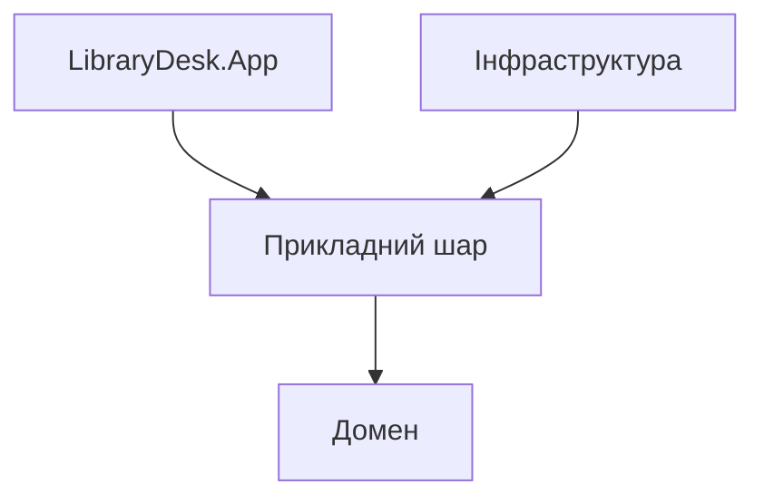

## Архітектура системи LibraryDesk

### Шари системи

| Шар | Що містить | Що заборонено |
| --- | --- | --- |
| Домен | `Domain` | Залежності від інфраструктури, файлового введення-виведення та зовнішніх сервісів |
| Прикладний | `Abstractions`, `Services`, `Pricing`, `Reports` | Залежності від консольного застосунку та деталей збереження даних |
| Інфраструктура | `Storage`, `Notifications` | Керування сценаріями меню та розміщення бізнес-правил |
| Застосунок | `LibraryDesk.App` | Реалізація доменної логіки та безпосереднє керування сховищем поза композиційним коренем |

- **Домен:** містить основні сутності системи, зокрема видачі, книги, читачів і стани видач. Визначає правила та переходи між станами.
- **Прикладний шар:** координує роботу з видачами, реалізує сервіси, політики розрахунку вартості та формування звітів.
- **Інфраструктурний шар:** забезпечує збереження даних і надсилання сповіщень.
- **Застосунок:** відповідає за взаємодію з користувачем і запуск сценаріїв роботи системи.

### Схема залежностей

### Принципи архітектури

- Доменний шар не залежить від зовнішніх шарів.
- Прикладний шар використовує доменні сутності та абстракції.
- Інфраструктура реалізує інтерфейси, визначені прикладним шаром.
- Застосунок відповідає за налаштування залежностей і взаємодію з користувачем.
